  

<h1 align="center">Hi, I'm Xianjin Lin</h1>

  Graduate student at <strong>Qinghai University</strong> 
  Nonlinear dynamics · Biomedical signals · Reproducible research

  <a href="#research">Research</a> ·
  <a href="#projects">Projects</a> ·
  <a href="#toolbox">Toolbox</a> ·
  <a href="https://orcid.org/0009-0002-4046-7302">ORCID</a> ·
  <a href="https://github.com/xianjin-lin?tab=repositories">Repositories</a>

I explore mechanical dynamics and physiological signal processing through data-driven modelling and reproducible experiments.

## Research

- **Dynamics & vibration:** nonlinear systems and vibration analysis.
- **Physiological signals:** PPG signal quality and heart-rate estimation.
- **Reliable models:** selective prediction, robustness and careful evaluation.

## Selected projects

| Project | What you can explore |
| :--- | :--- |
| [Selective PPG HR reporting](https://github.com/xianjin-lin/selective-ppg-hr-reporting) | Rhythm-specific coverage and reliable-output yield. [Interactive demo ↗](https://xianjin-lin.github.io/selective-ppg-hr-reporting/) |
| [PPG initialisation × inference](https://github.com/xianjin-lin/ppg-initialisation-inference) | Paired evaluation and a synthetic recursion lab. [Research explorer ↗](https://xianjin-lin.github.io/ppg-initialisation-inference/) |
| [QHU Cover Letter Template](https://github.com/xianjin-lin/QHU-Cover-Letter-Template) | A reusable LaTeX submission-letter template with university letterhead. |

## Toolbox

`Python` · `PyTorch` · `NumPy` · `MATLAB` · `Matplotlib` · `LaTeX` · `Git` · `Docker` · `Linux / WSL2`

Questions or collaboration ideas? Open an issue in the relevant project.

---

  <em>Build carefully. Verify results. Share what is useful.</em>  
  <strong>志比昆仑，学竞江河</strong>

